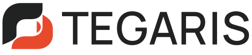
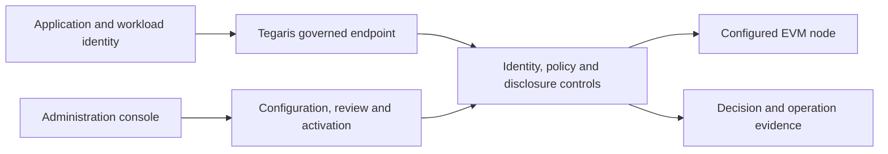

# Tegaris Application Layer Privacy

<picture>
  <source media="(prefers-color-scheme: dark)" srcset="docs/assets/brand/tegaris-logo-light.svg">
  
</picture>

Tegaris applies access and disclosure policies to applications on shared EVM networks. It connects participant identity, contract permissions, policy review and runtime enforcement in one administration console.

Tegaris is an [LF Decentralized Trust Lab](https://lf-decentralized-trust-labs.github.io/labs/approved/tegaris.html), initially contributed by Zeeve.

## What you can work on

- Organizations, users, workloads and scoped access.
- Contract and ABI registration, network bindings and method policies.
- Policy authoring, simulation, independent review and release management.
- Governed RPC requests and participant-scoped data disclosure.
- Runtime status, decision history and operational evidence.

The first public source release is being prepared as **v0.9.0**. Start with the [v0.9.0 release notes and getting-started checks](docs/releases/v0.9.0.md), including its known limitations and validation status.

## Get started

**Getting started?** Start with [ONBOARDING.md](ONBOARDING.md) for the first workspace, expected results and the boundary between initial checks and application testing.

**Building an integration?** Use the [integration guide](docs/development/integration.md) and [interface reference](docs/reference/interfaces.md), including the published schemas and their coverage limits.

**Exploring the demo?** The [demo guide](docs/demo.md) covers the fictional institutions, sample payment records, access arrangements and walkthroughs.

Follow the [local setup guide](docs/getting-started.md) on a dedicated Linux machine with systemd and a local Docker Engine. Start by checking prerequisites:

```sh
bash scripts/operations/policy-testing.sh check
```

Then complete the guide's dependency installation and service-image build before starting the workspace. Dependency installation alone does not build the seven application images. The guide gives the pinned tool versions, resource requirements, build command, initialization steps, development-account handling and shutdown procedure.

New workspaces started through that guide use the current Tegaris console. Keep their data directory outside the checkout and use synthetic data for testing.

## How it fits



Tegaris governs the configured application interface. Direct access to a node or database is a separate deployment boundary. Read the [architecture](docs/architecture.md) and [privacy model](docs/security/privacy-model.md) when defining that boundary for an institution.

## Documentation

| Audience               | Start here                                                                              |
| ---------------------- | --------------------------------------------------------------------------------------- |
| Administrators         | [Console guide](docs/user-guide/README.md)                                              |
| Application developers | [Integration guide](docs/development/integration.md)                                    |
| Contributors           | [Development guide](docs/development/README.md)                                         |
| API consumers          | [API contracts](docs/reference/interfaces.md)                                           |
| Security reviewers     | [Security policy](SECURITY.md) and [privacy boundaries](docs/security/privacy-model.md) |

## Contribute

Bug reports, documentation improvements, tests and code contributions are welcome. Read [CONTRIBUTING.md](CONTRIBUTING.md) before opening a pull request. Contributions require DCO sign-off.

Project contacts are listed in [MAINTAINERS.md](MAINTAINERS.md). Decisions and review responsibilities are described in [GOVERNANCE.md](GOVERNANCE.md).

For questions and bug reports, see [SUPPORT.md](SUPPORT.md). The [architecture overview](docs/architecture.md) explains how the application, console and governed endpoints fit together.

See the [contribution priorities](CONTRIBUTION_PROPOSAL.md) for useful starting points. If you use Tegaris in a project and can share that publicly, add it to [ADOPTERS.md](ADOPTERS.md).

## Test your integration

Application and platform teams can use the [validation guide](docs/evaluation/README.md) to assess a defined workflow with synthetic data. It covers architecture boundaries, reproducible setup, allowed and denied behavior, recovery and operational evidence.

Start with the [documentation index](docs/README.md). Operators should also read [operations and recovery](docs/operations/README.md); developers should use the [interface reference](docs/reference/interfaces.md) to distinguish administrative session APIs from workload/runtime interfaces.

v0.9.0 has known functional and operational limits, including a failing permitted RPC request. Review the [known issues](docs/releases/v0.9.0.md#known-issues-and-limits) before choosing an integration workflow. A running demo or documented interface does not establish production qualification, regulatory compliance or a support commitment. See [release scope](docs/releases/README.md) for the current limits.

## License

Project code uses [Apache-2.0](LICENSE). Project documentation uses [CC-BY-4.0](LICENSES/CC-BY-4.0.txt); code examples use Apache-2.0. See [licensing](LICENSES/README.md) for scope and third-party notices, and [CONTRIBUTING.md](CONTRIBUTING.md) for contribution terms.
