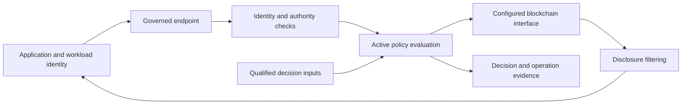
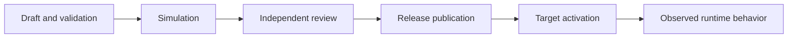

# Architecture and trust boundaries

Tegaris places identity, authorization, policy evaluation and disclosure controls around configured application interfaces to shared EVM networks. Administration services manage their configuration and lifecycle; runtime components apply them to application requests.

Tegaris does not change blockchain consensus or encrypt otherwise public chain data. An actor with unrestricted node access can observe what that node exposes. Network and access controls outside Tegaris are therefore part of the deployment boundary.

## Logical components

| Component group                   | Responsibility                                                   | Architecture review question                                 |
| --------------------------------- | ---------------------------------------------------------------- | ------------------------------------------------------------ |
| Administration console            | Configuration, review, operation and investigation workflows     | Which human identity and organization authorize each task?   |
| Identity and participant services | Human/workload identity, membership and authority context        | How are identities admitted, expired, revoked and recovered? |
| Control services                  | Persist configuration and coordinate durable changes             | How is an uncertain request reconciled without repeating it? |
| Policy components                 | Represent, validate, compile and distribute policy               | Which version was reviewed, released and acknowledged?       |
| Runtime enforcement               | Evaluate requests at governed interfaces                         | Can application traffic bypass this boundary?                |
| Fact and indexing components      | Supply decision inputs and permitted views of chain-related data | What provenance, freshness and finality assumptions apply?   |
| Evidence and operational support  | Record outcomes and support recovery                             | Who may read/export records, and what retention applies?     |

These are logical responsibilities, not a prescribed deployment count. The repository contains TypeScript services, Rust components, shared libraries and generated contracts. Check topology and capabilities against the selected release.

## Application request path

1. The application presents credentials required by the selected interface. Request-body identifiers do not replace authenticated transport identity.
2. The service resolves the caller's participant, workload and permitted scope.
3. The runtime evaluates active policy for the requested operation and resource.
4. Required decision inputs must meet their validity conditions. Missing or stale inputs must not become unrestricted access.
5. An admitted operation reaches the configured downstream interface.
6. Response data is subject to disclosure controls. Permission to request an operation does not authorize every field, event or related record.
7. The application retains the operation or transaction reference needed to reconcile its result.

See [integration](development/integration.md) for caller behavior and [privacy](security/privacy-model.md) for boundary assumptions.

## Administrative change path

This is a conceptual sequence, not an exhaustive API state enum. Each resource's contract defines its states and transitions.

The requester supplies a specific intent and version. The reviewer evaluates that intent under the required authority. Publication coordinates the selected release. The runtime target must then establish the corresponding activation state. An approval response cannot substitute for target activation evidence.

Changes requiring step-up authentication or independent approval retain those requirements in the console. A disabled button, hidden field or client-side validation result is not an authorization boundary.

## Durable state and recovery

Durable state includes identity and authority records, configuration revisions, approval requests, releases, runtime observations and operation outcomes. Consistency requirements differ by subsystem; a backup of one database alone does not establish whole-environment recovery.

After an uncertain write, preserve the original intent, idempotency key and operation reference required by the interface. Read the existing outcome before submitting another change. A new key can create a new business operation rather than recover the first one.

Recovery must preserve the relationship between stored state, signing material, issuer configuration and runtime identity. Copying live databases or replacing keys independently can break that relationship. See [operations](operations/README.md).

## Boundaries to record during integration testing

| Boundary                                      | Test record                                                                                |
| --------------------------------------------- | ------------------------------------------------------------------------------------------ |
| Institutional identity provider to Tegaris    | Issuer, client registration, callback origin, identity mapping and recovery responsibility |
| Human administration to application execution | Separate identities, roles, credentials and evidence for each path                         |
| Participant to participant                    | Membership, workload grants, resource scope and tests using independent organizations      |
| Tegaris to signing/custody provider           | Key ownership, permitted signing purposes, rotation and failure behavior                   |
| Runtime to node/provider                      | Endpoint identity, network path, allowed methods and bypass controls                       |
| Decision source to policy evaluation          | Provenance, freshness, chain reference and reorganization handling                         |
| Evidence to analysts                          | Read/export authorization, redaction, retention and integrity requirements                 |

These are deployment-specific decisions. The repository cannot establish the adequacy of an institution's surrounding network, custody or operating controls.

## Source ownership map

| Directory                         | Main use                                                          |
| --------------------------------- | ----------------------------------------------------------------- |
| `apps/admin-web`                  | Console components and backend-for-frontend integration           |
| `services`                        | Application services and Rust runtime components                  |
| `crates`                          | Shared Rust domain and protocol libraries                         |
| `packages`                        | Shared TypeScript contracts, security utilities and UI support    |
| `schemas`, `proto`                | HTTP, event and service contracts                                 |
| `generated`                       | Generated contract projections                                    |
| `migrations`                      | Database evolution owned by each subsystem                        |
| `deploy`, `containers`, `scripts` | Packaging, deployment examples and operational tools              |
| `tests`                           | Contract, integration, privacy, recovery and browser verification |

Identify the authoritative owner and affected consumers before changing a console form. See [development](development/README.md) and [testing](development/testing.md).

## What this description establishes

This guide describes responsibilities and review questions. It does not establish throughput, resilience or fitness for a particular bank workflow. Release-specific tests, deployment configuration and measured outcomes determine what has been verified.
