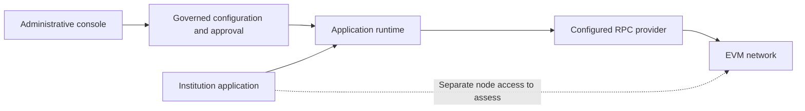

# Privacy model

Tegaris enforces access and disclosure rules at configured application interfaces on a shared EVM network. This guide describes the boundary an evaluator must preserve and the questions a security review should answer. It does not certify a deployment or establish compliance with an institution's regulatory obligations.

## Protected decisions

A request is evaluated in the context of authenticated identity, participant membership, granted authority, resource scope, the requested operation and applicable active policy. Where decisions use indexed or external data, provenance, freshness and chain-validity requirements also apply.

The design separates permission to perform an operation from permission to receive information. A permitted transaction does not authorize every associated receipt, event, record or field. A read must return the caller's authorized projection rather than merely filter the navigation shown in the console.

## Deployment assumptions

| Assumption                                                      | Why it matters                                                            | Evidence to seek                                          |
| --------------------------------------------------------------- | ------------------------------------------------------------------------- | --------------------------------------------------------- |
| Applications use governed interfaces                            | Unrestricted node access can bypass application-layer disclosure controls | Network routes, endpoint inventory and a bypass test      |
| Identities are admitted through trusted owners                  | A claimed participant/workload identifier is not authentication           | Credential issuance, binding, expiry and revocation tests |
| Administrative authority is separate from application execution | Human sessions should not become shared service credentials               | Role separation and distinct credential inventories       |
| Signing material remains in an approved custody boundary        | A leaked key can undermine otherwise correct checks                       | Storage, access, signing-purpose and rotation controls    |
| Required decision inputs are qualified                          | Stale or invalid observations must not become authorization               | Freshness, provenance and reorganization tests            |
| Recovery preserves state and identity relationships             | Restoring only data or only keys can produce inconsistent authority       | Tested recovery of the defined consistency set            |

Tegaris does not encrypt public on-chain data, alter consensus confidentiality or conceal data from a caller with unrestricted access to the underlying node. Evaluate these limits before choosing the architecture.

## Identity and organization isolation

Use at least two independent organizations in an integration test. Test the same resource and operation with an authorized actor, an unauthorized actor in the same organization and an actor in another organization.

Isolation includes list results, search, resource details, exports, events, error responses and recovery/status paths. A denied object lookup should not reveal protected existence through a different title, timing-dependent message or broader collection query.

Changing the selected organization in the browser must not retain data or pending actions from the previous context. Client-side state cleanup supports usability; server-side authorization remains the enforcement boundary.

## Policy lifecycle and independent review

Policy versions should be evaluated as immutable selected intents through validation, review, publication and activation. Reviewers need enough information to understand the affected identities, resources, operations and disclosure changes.

An authorized review and a target's active policy are separate facts. Test stale reviews, changed versions, insufficient reviewer authority and unavailable target activation. A UI success message does not establish enforcement by the runtime.

Step-up authentication must be tied to the operation and lifetime defined by its contract. An earlier authentication ceremony is not indefinite permission for unrelated changes.

## Facts, events and chain state

Where a decision depends on external or indexed observations, identify the source, observation time, required freshness, chain reference and applicable finality assumptions. Define what the application does if any prerequisite is unavailable.

Test reorganization and replay cases where relevant to the selected feature. A previously observed event may no longer be valid for a later decision. Reconnection must resume from the supported durable position and reauthorize access; it must not turn a prior subscription into permanent visibility.

## Failure and recovery behavior

| Condition                             | Required review question                                              |
| ------------------------------------- | --------------------------------------------------------------------- |
| Missing, expired or revoked authority | Is the request rejected without an unauthorized effect?               |
| Invalid or unavailable required input | Does access remain constrained, with a truthful unavailable result?   |
| Lost mutation response                | Can the original operation be reconciled without duplicate execution? |
| Stale configuration or approval       | Is the conflict detected before applying a different intent?          |
| Restart or partial recovery           | Are durable identities, operation references and outcomes preserved?  |
| Cross-organization lookup             | Does the response avoid leaking protected existence or fields?        |

Do not accept a failure for the wrong reason as proof of a security property. For example, an expired credential cannot establish that a separate live-revocation test passed.

## Logs, evidence and data minimization

Evidence remains access-controlled data. Confirm who can view it, what fields can be exported and how retention and deletion are handled. Operational access to a log store does not automatically justify unrestricted access to business payloads.

Exclude passwords, authorization codes, session cookies, private keys and confidential payloads from routine logs. Avoid query-string access logging on identity-provider callback routes. Use synthetic fixtures for public bug reports and regression tests.

## Map the deployed data path

Review the topology used by the application, including paths outside the console. A useful starting point is:

Adapt this diagram to the selected deployment. Identify the owner, authentication boundary, network route and permitted data at every connection. Approval of configuration and execution of an application request are separate paths.

Check where the full request and unfiltered result can be observed. Include the application, browser or service traces, runtime, RPC provider, node operators, indexing systems, log collectors and exported evidence. Filtering the response sent to an application does not remove information already available to a provider or a network participant.

Inventory alternative access to the same information: direct RPC listeners, explorer endpoints, subscriptions, exports, debug interfaces, backups and replicated chain state. Restricting the console alone cannot protect these paths. Where underlying data remains readable, document that limit explicitly and assess whether the institution needs a separate confidentiality mechanism.

## Prepare a disclosure test matrix

Use synthetic records with distinct values so that an unexpected field or another organization's data is easy to detect. Define the permitted output before sending the request. Record the relevant source revision, runtime configuration and policy identity alongside each result.

| Case                                       | Setup                                                                                                   | Evidence to inspect                                                                                                                |
| ------------------------------------------ | ------------------------------------------------------------------------------------------------------- | ---------------------------------------------------------------------------------------------------------------------------------- |
| Authorized read                            | The admitted application has the required scope and the selected policy permits the request.            | The returned record and fields match the declared projection; the result belongs to the selected network and contract binding.     |
| Same organization, insufficient permission | Another admitted actor in the same organization lacks the required operation or disclosure grant.       | No protected result or unintended effect is returned. Membership alone does not substitute for the missing grant.                  |
| Different organization                     | An independently authenticated application requests the same resource using its own legitimate context. | Lists, details, subscriptions and errors preserve the expected organization boundary.                                              |
| Changed selection                          | The user changes organization, privacy domain or network while earlier requests are still pending.      | Earlier results and pending actions do not appear under the new selection; late responses cannot restore the prior context's data. |
| Expired credential                         | A previously admitted credential has passed its validity limit.                                         | The request fails at the expected identity boundary without application execution.                                                 |
| Revoked grant with a valid credential      | Keep the credential valid and revoke the relevant permission through the supported owner.               | A fresh request is rejected because of the grant's state; expiry or a transport failure is not the reason for rejection.           |
| Unavailable policy prerequisite            | Make one required observation unavailable in the controlled test.                                       | The application receives the contract's constrained failure result rather than a broader response or an assumed permission.        |
| Reconnect or replay                        | Reconnect a subscription or reconcile a request using its original supported identity.                  | Current authorization is evaluated and durable position/outcome is preserved without duplicate execution or expanded disclosure.   |

Use the endpoint's actual error contract when writing assertions. A `403`, timeout or empty result does not by itself prove the intended boundary: confirm the request reached the relevant owner with otherwise valid prerequisites. For a denied write, inspect the authoritative operation and affected resource to establish that no unauthorized effect occurred.

For field-level disclosure, compare the complete returned structure with the expected structure. Hiding a table column or suppressing a field in a screenshot does not establish that the API omitted it. Include nested values, arrays, associated receipts and error details in the comparison where they belong to the selected interface.

For event-derived visibility, record the selected chain reference and finality rule. Test the supported behavior after a relevant reorganization or invalidation. A prior delivery is evidence of what the caller received at that time; it is not permanent authorization to read later events or revised records.

## Keep review evidence useful and proportionate

Retain enough information to distinguish authentication, permission, policy evaluation, execution and disclosure outcomes. Use the operation's supported identifiers, correlation references and permitted diagnostics. Reconcile a lost response against the original durable operation before submitting another intent.

Keep exact expected and observed synthetic outputs with the test. A successful response, a valid signed record and the currently active runtime configuration establish different facts; record the observation needed by the application workflow. The [integration guide](../development/integration.md) explains workload authentication and application requests, while the [API reference](../reference/interfaces.md) explains operation status and contract locations.

Store sensitive assessment evidence under institutional access and retention controls. Public issues and contribution discussions should contain a minimal synthetic reproduction, the affected revision and the boundary that failed. Do not attach production records, private network details, reusable credentials or unredacted exports to demonstrate a defect.

## Development fixtures and production assessment

Development identity providers, local signing keys and synthetic initial trust exist to make controlled tests reproducible. They do not qualify enterprise identity integration, HSM custody, certificate renewal or production recovery.

Before a production assessment, name the owners for identity, signing, policy administration, runtime operation, incident response and recovery. Record the selected deployment's unsupported cases and test evidence. Use the [validation plan](../evaluation/README.md) and [operations guide](../operations/README.md) to organize that review.

## Reporting a suspected boundary failure

Preserve the source revision, synthetic reproduction, affected boundary and observed unauthorized result. Avoid publishing exploit details or confidential evidence. Follow [SECURITY.md](../../SECURITY.md) for private reporting.
