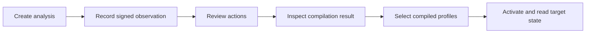

# Contract interactions

The **Contract interactions** workspace manages interaction analyses, signed observations, method grants, enforcement settings and compiled profiles. Application requests use the governed endpoint described in the [integration guide](../development/integration.md).

This guide follows the console's **Request type** choices. Use the [interface reference](../reference/interfaces.md) for authentication, version preconditions and operation records. Keep the documentation, schemas and deployed component on the same version.

## Prepare the workspace

Before creating a request, establish:

- The intended Participant and privacy domain, with permission to inspect the required records.
- The registered contract, ABI and method policy, including the exact selector and current revision.
- The runtime target, runtime binding and current generation digest.
- The admitted workload whose interaction is being analysed.
- The independent reviewer and authentication required for the selected action.
- Access to the deployment's trusted analysis target when a signed observation is needed.

Use current authorized readback for these values. A resource reference, workload reference, transaction hash and generation digest are different inputs. Preserve their representations; revisions are decimal strings and digests use the format specified by the selected schema.

## Follow the request sequence

| Request type                 | Main inputs                                                                             | Result to inspect                              |
| ---------------------------- | --------------------------------------------------------------------------------------- | ---------------------------------------------- |
| Create interaction analysis  | Analysis definition                                                                     | Analysis reference, revision, state and expiry |
| Record signed observation    | Analysis reference, revision `1`, signed receipt                                        | Verified observation and revision `2`          |
| Review interaction actions   | Analysis reference, revision `2`, action review definition                              | Review record and profile compilation state    |
| Create method grant          | Grant definition and current binding/method revisions                                   | Grant reference, revision and status           |
| Change method grant status   | Grant reference, revision, requested status and any required verified dependency bundle | Current grant status and dependent authority   |
| Publish interaction settings | Settings definition                                                                     | Published settings artifact and staged record  |
| Activate compiled profiles   | Runtime target, current revision/generation/epoch and exact profile selections          | Actual runtime target state after activation   |

For each request, enter a specific **Reason**, select **Review request**, and inspect the returned candidate before using the approval and execution controls offered for that action. A successful review does not establish that the change has been executed. Retain the original approval and operation references.

The analysis-to-profile sequence is:



Grant and settings changes have their own review and publication steps. Check their current records alongside the analysis and profile; success in one workflow does not establish completion of the others.

## 1. Create an interaction analysis

Choose **Create interaction analysis**. Complete the three visible sections using current authorized records:

| Section                | Inputs                                                                       | Check before review                                                                                |
| ---------------------- | ---------------------------------------------------------------------------- | -------------------------------------------------------------------------------------------------- |
| Runtime configuration  | Runtime target reference and installed generation digest                     | The digest belongs to the intended target's currently installed generation                         |
| Contract and method    | Runtime binding reference and revision, method policy reference and revision | The binding identifies the deployed contract, and the method policy belongs to that binding        |
| Transaction to analyse | Workload reference, transaction hash and analysis lifetime in seconds        | The exact workload transaction is intended, and the analysis can finish within its validity window |

References are complete URNs, not display names or bare UUIDs. Revisions remain decimal strings, including revisions too large to represent safely as JavaScript numbers. The lifetime is an integer from 30 through 900 seconds. The form does not choose a lifetime or supply a target, generation or revision on your behalf.

Select **Review request** after entering the reason. The console constructs the same analysis definition and surrounding administrative request used by the API. The service still validates the source bindings and your authority; completing the form does not establish that those prerequisites are satisfied.

For an existing definition or technical inspection, open **Edit analysis JSON**. It edits the same draft as the form. Closing the editor preserves the entered values. A malformed definition, an unsupported field or a value with the wrong JSON type stays available for correction in the editor; the console does not silently discard it or replace it with a default. Correct the definition to return to the labeled form.

### Analysis definition

This example illustrates the field formats. Its references, revisions, hashes and digests are synthetic. Obtain replacements from the intended authorized records before preparing a request.

```json
{
  "targetRuntimeId": "urn:openpc:resource:018f0000-0000-7000-8000-000000004001",
  "expectedGenerationDigest": "sha256:1111111111111111111111111111111111111111111111111111111111111111",
  "runtimeBindingId": "urn:openpc:resource:018f0000-0000-7000-8000-000000004002",
  "contractMethodPolicyId": "urn:openpc:resource:018f0000-0000-7000-8000-000000004003",
  "expectedRuntimeBindingRevision": "3",
  "expectedMethodRevision": "2",
  "workloadId": "urn:openpc:workload:018f0000-0000-7000-8000-000000004004",
  "transactionHash": "0x1111111111111111111111111111111111111111111111111111111111111111",
  "expiresInSeconds": 300
}
```

| Field group                   | What to verify                                                                                                     |
| ----------------------------- | ------------------------------------------------------------------------------------------------------------------ |
| Runtime target and generation | The intended target and its current generation digest                                                              |
| Binding and method            | The registered binding and method policy, with their current revisions                                             |
| Workload                      | The admitted workload for this interaction, using its workload URN                                                 |
| Transaction hash              | The exact transaction identified by the analysis request                                                           |
| Lifetime                      | An integer from 30 through 900 seconds; use the returned `expiresAt` when deciding whether the job is still usable |

Read and retain the returned analysis reference and revision. An analysis begins at revision `1`. Its response reports `runtimePermission: NONE`; creating the analysis does not grant execution permission.

## 2. Record the signed observation

Obtain the signed analysis receipt from the trusted target through the deployment's analysis integration. Select **Record signed observation** and supply the original analysis reference, expected revision `1` and exact receipt bytes in the required `0x` hexadecimal representation.

The receipt is checked against the target trust configuration and the original job bindings, including the transaction, workload, runtime binding, method, generation and validity window. Displayed analysis JSON cannot replace the signed receipt or supply a new trust key.

Read the resulting observation. A verified observation advances the analysis to revision `2` and state `OBSERVED`. The observation remains evidence about the analysed interaction; its authority is `OBSERVATION_ONLY`.

## 3. Review the observed actions

Choose **Review interaction actions**, using the analysis reference and expected revision `2`. Build the **Action review definition** from the verified observation:

| Field                    | Required representation                                                                         |
| ------------------------ | ----------------------------------------------------------------------------------------------- |
| `analysisDigest`         | The returned analysis digest, including its `sha256:` prefix                                    |
| `actions`                | The complete observed interaction set, with one entry per interaction and at most 2,048 entries |
| `actions[].actionDigest` | The exact observed action digest                                                                |
| `actions[].maximumValue` | Exactly 32 byte values, each an integer from 0 through 255                                      |
| `program`                | A supported program object, or `null`, as required by the intended review                       |

The review must cover every observed interaction exactly once, without duplicate action digests. An analysis with unresolved interactions cannot be accepted for review. Resolve the registration or policy prerequisites through the supported workflow and investigate the original job's outcome before preparing another analysis.

Use each observed call's accepted value encoding. A decimal JSON number or an arbitrary textual amount does not satisfy the 32-byte field. Static calls require a zero value bound. The compiler validates program instructions and fields; schema parsing alone does not establish that a program is valid for the observed sources.

After approval and execution, inspect the review and compilation record. The reviewed analysis advances to revision `3`. Compilation can report `REQUIRED`, `PENDING`, `RUNNING`, `COMPILED` or `FAILED`. Read the permitted diagnostic when compilation fails. Profile readback reports `runtimePermission: NONE`; confirm activation separately on the runtime target.

## 4. Create or change a method grant

Choose **Create method grant**. Complete the visible sections, then enter the current runtime-binding and method revisions:

| Section                    | What to enter                                                                  |
| -------------------------- | ------------------------------------------------------------------------------ |
| **Contract and method**    | The runtime binding reference and exact lowercase method selector              |
| **Recipient**              | The recipient type and its reference or identifier                             |
| **Interface and decision** | The interface the rule applies to and an explicit **Allow** or **Deny** choice |

Changing **Recipient type** clears its reference so a role identifier is not silently reused as a workload or user. **Any authenticated subject** has no identifier field; choose it only when that is the intended scope of the rule. No recipient, interface or decision is selected for you.

Use **Edit grant JSON** when working with an existing definition. It edits the same draft as the visible fields. A malformed definition or one containing unsupported fields stays available in that editor without dropping its contents. Review the request through the normal workflow after completing the draft.

### Method grant definition

The following example proposes a deny rule for a synthetic workload and selector:

```json
{
  "runtimeBindingId": "urn:openpc:resource:018f0000-0000-7000-8000-000000004002",
  "selector": "0x11223344",
  "subject": {
    "kind": "WORKLOAD",
    "id": "urn:openpc:workload:018f0000-0000-7000-8000-000000004004"
  },
  "surface": "ETH_CALL",
  "effect": "DENY"
}
```

Subject kinds have distinct identifier formats:

| Subject kind                   | Identifier                           |
| ------------------------------ | ------------------------------------ |
| `ROLE`                         | Role URN                             |
| `WORKLOAD`                     | Workload URN                         |
| `USER`, `GROUP`, `PARTICIPANT` | UUID in the selected schema's format |
| `ANY_AUTHENTICATED`            | No `id` field                        |

The surface is one of `ETH_CALL`, `ETH_ESTIMATE_GAS`, `PREPARE_WRITE`, `RAW_SUBMISSION`, `DEPLOYMENT_CONSTRUCTOR` or `RUNTIME_WRITE_TRACE`. Select the surface that the reviewed rule is intended to govern. The effect is `ALLOW` or `DENY`.

A newly created shared grant starts `DISABLED`. To change it, select **Change method grant status**, use its current reference and revision, and request `ACTIVE` or `DISABLED`. Activation can require a verified dependency bundle. A disabling request must not import a dependency bundle.

Read the returned status and dependent authority. Grant responses report `runtimePermission: NONE_WITHOUT_CURRENT_PROFILE`. An active grant therefore needs the current profile and other runtime authority required by the consuming request. Disabling a source grant invalidates dependent runtime authority.

## 5. Publish interaction settings

Choose **Publish interaction settings**. Prepare the settings definition from the approved deployment configuration and review each group:

- Schema version `1.0` and either an all-chains scope or an exact chain/network/genesis scope.
- Mode, enforcement surfaces and fail-closed/state-override behavior.
- Trace provider, depth/frame/response limits and timeout.
- Readiness scope and schema fallback behavior.
- Precompile and system-contract allowlists.
- Post-mine checking and divergence behavior.

The trace-limit fields use these bounds:

| Field              | Accepted range           |
| ------------------ | ------------------------ |
| `maxDepth`         | 1–128 frames of depth    |
| `maxFrames`        | 1–2,048 total frames     |
| `maxResponseBytes` | 100,000–20,000,000 bytes |
| `timeoutMs`        | 500–30,000 milliseconds  |

The shared validator checks supported combinations. A definition passing JSON parsing does not establish that its enforcement settings are supported or ready. Retain the returned artifact digest and read back the settings record. It reports `STAGED` with `runtimePermission: NONE`; target activation has a separate outcome.

## 6. Select and activate compiled profiles

Choose **Activate compiled profiles** after inspecting the compilation result and current target sources. Enter the runtime target reference, current target revision, expected generation digest and Participant epoch.

### Compiled profile selections

The **Compiled profile selections** field is an array with 1 through 64 entries, ordered by `profileId` with no duplicates. Each entry pins the profile revision and all three digests shown here:

```json
[
  {
    "profileId": "urn:openpc:resource:018f0000-0000-7000-8000-000000004005",
    "profileRevision": "1",
    "profileDigest": "sha256:1111111111111111111111111111111111111111111111111111111111111111",
    "compilationArtifactDigest": "sha256:2222222222222222222222222222222222222222222222222222222222222222",
    "grantSourcesDigest": "sha256:3333333333333333333333333333333333333333333333333333333333333333"
  }
]
```

Use the actual compiled profile and current publication-source readback. Profile compilation and its source pins do not establish that the target has been activated. If a required current source is unavailable or has changed, resolve that result before requesting activation.

For a policy renewal, the optional **Approved policy renewal** field identifies its approved activation occurrence, expected revision and policy generation digest. Use the record from the [policy activation renewal workflow](README.md#8-publish-and-verify-activation); preserve the original release approval as historical evidence.

After the required approval and execution, read the actual runtime target state. Check the installed generation and selected profile records before testing an application request through the governed endpoint.

## 7. Investigate an uncertain result

Use **Activity** and the original approval/operation references to inspect progress. A successful status read, successful administrative mutation and effective runtime permission are separate observations.

Open **Recover an existing request** only when recovering the same intent. Preserve the original proposal key, reserved approval operation ID and unchanged business inputs. A new proposal key can represent another mutation; it cannot establish what happened to the first request.

Keep the original signed receipt and returned digests when investigating a stale revision, expired analysis, unavailable source or ambiguous write. Obtain current authorized readback before deciding whether a supported continuation is available. Follow [troubleshooting](troubleshooting.md) for a reproducible report.

## Schema references

The examples above are checked against the field schemas. They demonstrate structure and do not establish authorization, current source bindings or successful execution.

- [Analysis, observation and action review fields](../../services/control-api/src/configuration/cigl/analysis-contract.ts).
- [Method grant fields](../../services/control-api/src/configuration/cigl/grant-contract.ts).
- [Settings fields](../../services/control-api/src/configuration/cigl/settings-contract.ts).
- [Compiled profile selection and activation fields](../../services/control-api/src/configuration/cigl/activation-contract.ts).
- [Profile compilation readback](../../services/control-api/src/configuration/cigl/profile-contract.ts).

For application identity, transport and request handling, continue with the [integration guide](../development/integration.md). For proposed changes to these contracts, use the [proposal guide](../development/proposals.md) and [testing guide](../development/testing.md).
